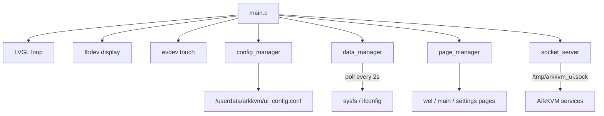

# arkkvm-display-app

On-device touchscreen UI for [ArkKVM](https://www.arkkvm.com/) hardware.

## Overview

This repository contains **arkkvm_ui**, the embedded LVGL application that runs on the ArkKVM device's local display. It shows network and connection status, lets users adjust display settings, and communicates with other ArkKVM services over a Unix socket.

[ArkKVM](https://www.arkkvm.com/) is an open-source, all-in-one remote KVM platform. This project is the firmware UI layer—not the remote KVM stack itself.

## Related Links

| Resource | URL |
|----------|-----|
| Website | https://www.arkkvm.com/ |

## Features

- **Welcome and main screens** — boot splash, then the primary status dashboard
- **Network information** — IPv4, IPv6, MAC, and VLAN-aware layouts
- **Connection indicators** — HDMI and USB plug status
- **Settings** — screen orientation, brightness, dark-screen timeout, and sleep timeout
- **About and reboot** — firmware/system version, serial number, device reboot
- **Idle power management** — automatic dimming and sleep with touch wake-up

## Architecture



| Module | Role |
|--------|------|
| `page_manager` | Page routing: welcome, main, settings, about, reboot |
| `data_manager` | Polls sysfs and shell commands for IP, MAC, HDMI, USB, versions |
| `config_manager` | Loads and persists UI settings on device |
| `socket_server` | Unix socket IPC for remote configuration and network reports |

Display: 240×284 framebuffer via `fbdev`, rotated 90°. Input: `evdev` touch.

## Requirements

- Linux build host
- Cross-compilation toolchain for `arm-rockchip830-linux-uclibcgnueabihf`

The [Makefile](Makefile) expects:

```text
/opt/arkkvm-native-buildkit/bin/arm-rockchip830-linux-uclibcgnueabihf-cc
```

An alternative toolchain layout is `~/arkkvm-devel/arm-rockchip830-linux-uclibcgnueabihf`. Update `CC` in the Makefile if needed.

## Building

```bash
make
```

Produces `bin/arkkvm_ui`.

```bash
make clean
```

## Running

Runs on ArkKVM target hardware with framebuffer and evdev input:

```bash
./bin/arkkvm_ui
```

Logs:

- `/userdata/arkkvm/logs/arkkvm_ui.log` — application log, rotated at 20 MiB, at most 2 files (`arkkvm_ui.log` + `.1`)
- `/userdata/arkkvm/log/arkkvm_ui.log` — startup stdout/stderr redirect, truncated at 20 MiB

Also print the same application logs to stdout:

```bash
./bin/arkkvm_ui debug
```

## Configuration

Settings are stored at:

```text
/userdata/arkkvm/ui_config.conf
```

| Key | Description | Default |
|-----|-------------|---------|
| `orientation` | `1` = normal (90°), `0` = inverted (270°) | `1` |
| `sleep_time` | Sleep timeout in seconds (`0` = disabled) | `1800` |
| `screen_luminance` | Backlight level | `64` |
| `dark_screen_time` | Dark-screen timeout in seconds (`0` = disabled) | `0` |
| `version` | Config schema version | `1` |

## IPC

The UI listens on a Unix domain socket:

```text
/tmp/arkkvm_ui.sock
```

Send `KEY=VALUE` commands (one per connection). Responses are plain text.

| Command | Value | Response | Description |
|---------|-------|----------|-------------|
| `GET_CONFIG` | — | `ORIENTATION=…,LUMINANCE=…,DARK_SCREEN_TIME=…,SLEEP_TIME=…` | Read current settings |
| `SCREEN_ORIENTATION` | `0` or `1` | `OK` | Set display rotation |
| `SCREEN_LUMINANCE` | `0`–`255` | `OK` | Set backlight level |
| `DARK_SCREEN_TIME` | seconds | `OK` | Set dark-screen timeout |
| `SLEEP_TIME` | seconds | `OK` | Set sleep timeout |
| `REPORT_IPV6_ADDRESSES` | address list | `OK` | Push IPv6 addresses from host service |
| `REPORT_VLAN_CONFIG` | VLAN config | `OK` | Push VLAN configuration |
| `REPORT_VLAN_IPV6_ADDRESSES` | address list | `OK` | Push per-VLAN IPv6 addresses |

Unknown commands return `ERROR=Unknown command`.

Example:

```bash
echo -n "GET_CONFIG" | socat - UNIX-CONNECT:/tmp/arkkvm_ui.sock
```

## Project Structure

```text
arkkvm-display-app/
├── src/
│   ├── main.c              # Entry point, LVGL init, main loop
│   ├── core/               # page_manager, data_manager, config_manager, socket_server
│   ├── pages/              # wel, main, settings, about, reboot
│   ├── components/         # Reusable UI widgets (navigation, network views)
│   └── utils/              # command, net, font, view helpers
├── font/                   # Embedded Funnel Sans fonts
├── img/                    # LVGL image assets
├── lvgl/                   # LVGL library (vendored)
├── lv_drivers/             # fbdev, evdev drivers (vendored)
├── Makefile
└── bin/arkkvm_ui           # Build output
```

## License

This project's original source code is licensed under the
[GNU General Public License v2.0 or later](LICENSE) (GPL-2.0-or-later).

Third-party components (LVGL, lv_drivers, cJSON, Funnel Sans, etc.) are
used under their respective licenses. See
[THIRD-PARTY-LICENSES.md](THIRD-PARTY-LICENSES.md).
